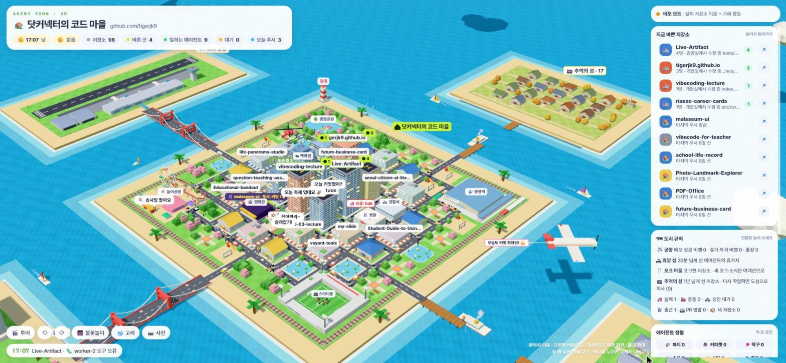
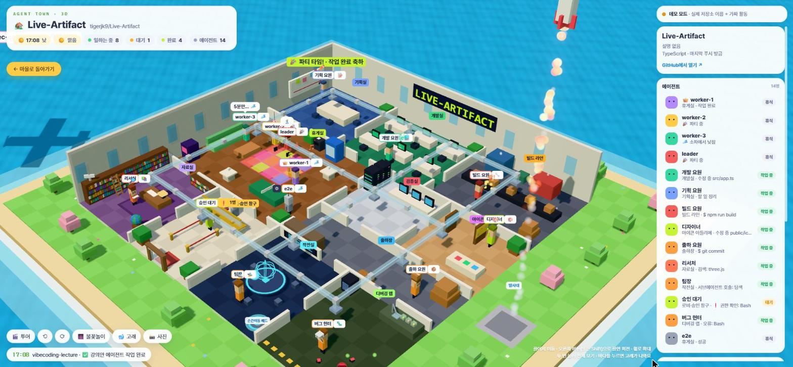
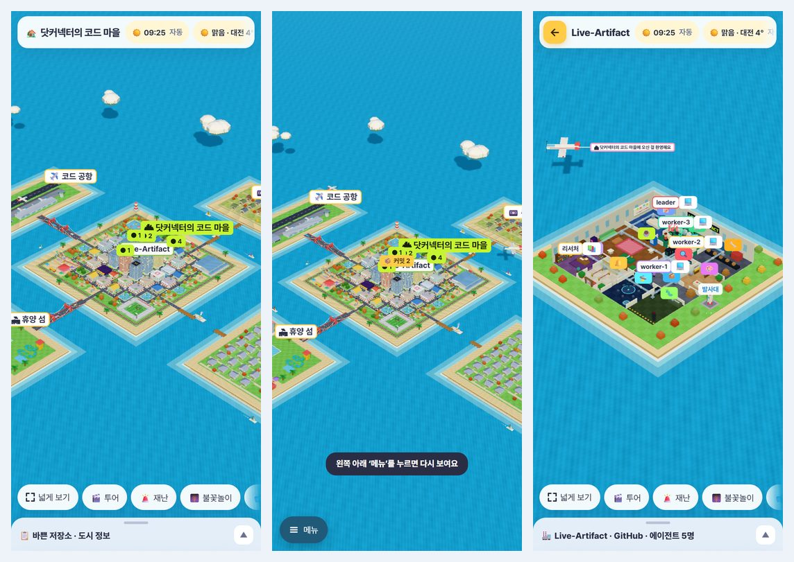

# 🏙 에이전트 타운 (Agent Town)

**내 GitHub 저장소 전체가 하나의 도시가 되고, 그 안에서 AI 에이전트들이 일하고 쉬는 모습을 실시간으로 보여 주는 대시보드**

👉 **바로 보기: https://tigerjk9.github.io/agent-town/**

- 저장소 하나가 건물 하나예요. 건물을 누르면 그 저장소의 **공장 안**이 열리고, 에이전트들이 기획실·개발실·검증실 사이를 오가며 일합니다.
- 푸시, PR, 빌드 실패, 배포, 휴가 같은 실제 사건이 비행기·구급차·여객선·불꽃놀이 같은 도시의 움직임으로 나타나요.
- 날씨는 대전의 계절을 따라 바뀌고, 가끔 지진·운석우·외계인·괴수가 찾아오면 도시의 방어 시스템이 막아 내요.
- 휴대폰·태블릿에서는 손가락으로 움직여요. **넓게 보기**를 누르면 메뉴가 모두 사라지고 도시만 화면 가득 보여요. 기기 성능에 맞춰 화질도 저절로 조절돼요.
- 다른 사람의 도시도 볼 수 있어요: `https://tigerjk9.github.io/agent-town/?user=아이디`
- 가짜 활동으로 움직이는 데모: 주소 끝에 `#demo`

| 마을 | 저장소 공장 안 |
|---|---|
|  |  |

휴대폰(세로)에서는 머리말이 한 줄로 줄고 정보 창은 아래 시트로 들어가요. 왼쪽부터 마을, 넓게 보기, 공장 안이에요.



---

## 1. 보는 방법 두 가지

| | 🔗 링크만 | 🔗 링크 + 💻 PC 도우미 |
|---|---|---|
| 설치 | 없음 | 처음 한 번 `setup.cmd` 더블클릭 |
| 보이는 것 | 저장소 도시, 푸시·PR·릴리스, GitHub Actions 빌드 로봇, 클라우드 Claude의 커밋 | 왼쪽 전부 + **내 PC에서 도는 Claude Code/OMC 에이전트의 실시간 움직임**(파일 단위) |
| 갱신 | 1~2분 간격 (GitHub API) | 에이전트는 즉시, GitHub는 30초~1분 |
| 비공개 저장소 | 토큰을 넣으면 보임 | `gh` 로그인 토큰을 자동으로 사용 |

PC 도우미가 켜져 있으면 링크 화면이 자동으로 도우미에 연결돼요. 크롬이 "로컬 네트워크 접근"을 물으면 **허용**을 누르세요. 연결되지 않으면 오른쪽 위 **PC 연결**을 누르면 됩니다.

---

## 2. 도시 구성

### 🏙 다운타운 섬: 1년 안에 작업한 저장소
- **건물**: 가장 활발한 8개는 이름 간판이 붙은 **마천루**, 그다음 14개는 **상가 건물**(줄무늬 차양·간판), 나머지는 정원과 울타리가 있는 **주택**이에요.
- **시설**: 🏛 시청, 🌳 중앙공원(호수·보트), 🎡 놀이공원(관람차·롤러코스터·회전목마), 🏟 스타디움, 🚉 중앙역, 🏥 병원, 🏫 학교, 📚 도서관, 🚒 소방서, 🚓 경찰서, 🎬 영화관, 🛍 백화점
- **교통**: 자동차·버스·택시가 도로를 달리고, 기차가 섬 둘레를 돌며 중앙역에 섭니다.
- **주민**: 산책하는 사람, 강아지와 걷는 사람, 술래잡기하는 아이들, 벤치의 주민, 상인, 낚시꾼이 가끔 말풍선으로 수다를 떨어요.

### 주변 섬
| 섬 | 누가 사나요 | 연결 |
|---|---|---|
| ✈️ **코드 공항** | 공항(활주로·관제탑·터미널) | 서쪽 다리 |
| 🏖 **휴양 섬** | 호텔·수영장·워터슬라이드·해변. 휴가 간 에이전트가 쉬는 곳 | 남쪽 다리 |
| 🍴 **포크 마을** | 포크한 저장소들 | 여객선 |
| 📼 **추억의 섬** | 1년 넘게 쉬고 있는 저장소들(풍차·단풍) | 여객선 |

### 하늘과 바다, 낮과 밤
- **하늘과 바다**: 배너 비행기, 헬기, 열기구, 갈매기가 날고, 돛단배·요트·고깃배·여객선이 다녀요.
- **낮과 밤**: 실제 시각에 따라 **낮 → 노을 → 밤**으로 바뀌어요. 밤에는 마천루 창문, 가로등, 경기장 조명, 등대 불빛이 켜지고 놀이공원 위로 불꽃놀이가 터집니다.
- **날씨와 계절**: 컴퓨터 날짜를 보고 **대전**의 계절 날씨를 따라가요. 그날 일어날 법한 날씨(맑음·흐림·비·뇌우·눈·안개·황사) 가운데 하나가 무작위로 오고, 8~20분마다 바뀔 수 있어요. 7월에는 장맛비가 잦고, 8월 오후에는 소나기와 뇌우가, 1월에는 눈이 오기 쉬워요. 칩에는 그 시각의 대전 기온도 함께 떠요.
- **나무 색**: 봄에는 개나리·벚꽃, 여름에는 짙은 초록, 가을에는 단풍과 은행, 겨울에는 눈 쌓인 나무가 돼요.
- 제목 아래 시계 칩을 누르면 자동·낮·노을·밤을, 날씨 칩을 누르면 자동·맑음·흐림·안개·황사·눈·비·뇌우를 직접 고를 수 있어요.

### 🚨 재난과 방어 시스템
심시티처럼 가끔 도시에 위기가 찾아와요. 처음 연 지 5~12분 뒤에 한 번, 그 뒤로는 10~25분마다 무작위로 와요. 경보 → 발생 → 대응 → 해결 순서로 진행되고, 도시의 첨단 방어 시스템이 언제나 막아 내요. 건물이 부서지거나 기록이 바뀌지는 않아요.

| 위기 | 막아 내는 시스템 |
|---|---|
| 🌍 지진 | AI 내진 댐퍼 기둥이 해변에 솟아 흔들림을 잡고, 갈라진 도로를 메워요 |
| 🌀 태풍 | 기상 제어 위성이 태풍의 눈에 빔을 쏴서 흩어 버려요 |
| ☄️ 운석우 | 레이저 요격 포탑이 운석을 하늘에서 모두 맞혀 떨어뜨려요 |
| 👽 외계인 침공 | 에너지 실드 돔이 도시를 덮고, 요격 드론 편대가 비행접시를 쫓아내요 |
| 🐉 괴수 출현 | 공항에서 거대 방어 로봇이 날아와 괴수를 바다로 돌려보내요 |
| 🌊 해일 | 해일 방어벽이 솟아 파도를 막아요 |
| 🌋 해저 화산 | 냉각 드론 편대가 용암을 식히고, 섬은 다시 바다로 가라앉아요 |

공장 안을 보고 있을 때는 오지 않고, 위기 중에 공장으로 들어가면 조용히 끝나요. 왼쪽 아래 **🚨 재난** 버튼이나 `D` 키로 바로 불러올 수 있어요. 휴대폰 세로 화면에서 태풍·해일·해저 화산·괴수가 닥치면 카메라가 그쪽으로 다가갔다가, 끝나면 원래 자리로 돌아와요. 도시 전체에 걸치는 지진·운석우·외계인 침공 때는 카메라를 당기지 않아요.

---

## 3. 도시의 규칙: 무슨 일이 생기면 어디가 움직이나

| 일어난 일 | 도시에서 |
|---|---|
| 배포 성공·릴리스 | ✈️ 공항에서 "🚀 ○○ 배포 완료!" 비행기 이륙 + 공장 로켓 발사 |
| 에이전트가 20분 넘게 쉼 | ✈️ 공항 → 🏖 휴양 섬 휴가 비행, 새 일이 오면 복귀 비행 |
| 한 세션이 다른 저장소로 옮겨 일함 | 🚁 출장 헬기: A 건물 옥상에서 떠서 모든 건물보다 높이 날아가 B 건물 옥상에 내려요 |
| 새 저장소 생성 | 🛬 입주 비행 + 🏫 입학 종 + 🏗 공사 크레인 |
| 빌드·테스트 실패, 도구 오류 | 🏥 병원에서 🚑 구급차 출동 |
| 같은 파일 동시 수정(충돌) | 🚒 소방차 출동, 물 뿌리기 |
| 권한 승인 대기 | 🚓 경찰차가 가서 승인될 때까지 대기 |
| 검색·웹 읽기·파일 읽기 | 📚 도서관 "조사 중 n명" |
| 새 세션 시작 / 종료 | 🚉 중앙역 출근·퇴근 안내 |
| 푸시 | 🛍 백화점에서 택배 출발(다른 섬은 드론), 🎬 영화관 상영, 비행기 배너 |
| PR 병합 | 🏟 스타디움 "골인!" |
| 작업 완료·배포 성공 | 🎉 공장 파티 |
| 쉬는 에이전트 | 🌳 중앙공원 산책 |
| 새 포크 / 포크 저장소 소식 | ⛴ 포크 마을행 여객선 |
| 1년 넘게 쉰 저장소에 다시 작업 | 📼→🏙 추억의 섬에서 도심으로 이사 |

- 시설을 누르면 사이드바에 그 시설의 규칙과 오늘 기록이 나와요. 마우스를 올리면 설명이 떠요.
- 🏛 **시청**을 누르면 오늘의 시정 보고(푸시·완료·PR·실패·충돌·MVP)를 볼 수 있어요.

---

## 4. 공장 안 (저장소를 누르면)

방은 11개예요. 에이전트는 하는 일에 맞는 방으로 걸어가서, 방마다 다른 동작으로 일해요.

| 에이전트가 하는 일 | 방 | 일하는 모습 |
|---|---|---|
| 새 요청, 할 일 정리 | 📝 기획실 | 화이트보드에 메모를 붙이고, 테이블에서 회의해요 |
| 파일 읽기·코드 검색·웹 조사 | 📚 자료실 | 사다리를 타고 책을 꺼내 읽어요. 웹 검색 중이면 옥상 안테나가 빨리 돌아요 |
| 서브에이전트 호출 | 🛸 작전실 | 원탁 홀로그램 앞에서 작전 회의. 불려 온 서브에이전트는 순간이동 패드로 도착하고, 일을 마치면 빛기둥과 함께 사라져요 |
| 코드 파일 수정 | 💻 개발실 | 타자를 치면 모니터에서 `</>` `{ }` 같은 코드 조각이 떠올라요. 가끔 고무 오리에게 설명도 해요 |
| `npm install`, `build`, `vite`, `tsc` 등 | 🔧 빌드 라인 | 렌치질·망치질에 불꽃이 튀고, 상자를 컨베이어에 올려요 |
| 테스트·린트·Playwright·스크린샷, 테스트 파일 수정 | 🔍 검증실 | 돋보기로 살피고 체크리스트에 표시해요. 서버 랙 불빛이 빨라져요 |
| 이미지·아이콘(svg/png) 수정, 디자인 도구 | 🎨 아이콘 아틀리에 | 이젤에 물감을 찍어 그림을 완성해요 |
| `git commit`, `git push`, 배포 | 📦 출하장 | 상자를 포장해 쌓고 출고해요. 성공하면 발사대에서 🚀 |
| 권한 승인·확인 대기 | 🔔 로비·승인 창구 | 창구에 줄을 서서 벨을 울려요. 승인되면 창구 로봇이 도장을 찍어 줘요. 새 에이전트도 이 정문으로 출근해요 |
| 빌드·테스트 실패, 도구 오류 | 🐛 디버깅 랩 | 경광등이 돌고, 잠자리채로 벌레를 잡아요 |
| 작업 끝 | ☕ 휴게실 | 아래 '에이전트 생활' 참고 |

- **읽기는 자리에서**: 개발실·빌드 라인·검증실에서 일하다가 잠깐 파일을 읽거나 검색하면 자료실로 가지 않고 그 방에서 읽어요. 웹 검색과 웹 읽기는 언제나 자료실로 가요.
- **공중 튜브**: 에이전트가 방을 옮기면 작업 캡슐이 천장 튜브를 타고 다음 방으로 먼저 날아가요(개발실 → 빌드 라인 → 검증실 → 출하장).
- **방 누르기**: 사이드바에 방 설명, 지금 그 방에 있는 에이전트, 그 방과 이어지는 GitHub 페이지 바로가기가 떠요. 예를 들어 빌드 라인은 Actions, 출하장은 커밋·릴리스, 디버깅 랩은 실패한 실행으로 이어져요.

> [!NOTE]
> 방 배정은 PC 도우미(`server.js`)가 정해요. 2026-11-18 이전에 설치했다면 `setup.cmd`를 한 번 다시 실행해 주세요. 도구 실패(`PostToolUseFailure`) 훅이 새로 연결되고 도우미가 다시 켜져야 실패한 명령이 🐛 디버깅 랩으로 가요. 작업을 마친 뒤 뜨는 "입력을 기다려요" 알림은 이제 승인 대기로 치지 않아요.

**에이전트 종류**
- **사람 모양**: 내 PC의 Claude Code/OMC 에이전트예요.
- **⚙ 로봇**: GitHub Actions예요.
- **☁ 보라 머리**: 클라우드에서 일한 Claude예요. `claude/` 브랜치 푸시나 Claude 공동 작성 커밋이 올라오면 나타나요.

**⚠️ 충돌 표시**: 두 에이전트가 같은 파일을 동시에 고치면 둘 다 머리 위에 ⚠️가 뜨고, 붉은 점선으로 이어집니다.

### 🎈 에이전트 생활
쉬는 에이전트는 가만히 있지 않아요.
- **☕ 커피챗·잡담**: 방금 고친 파일, 깨진 빌드 같은 실제 작업 기록에서 이야깃거리를 가져와요.
- **혼자 쉬기**: 🏓 탁구, 🎮 오락기, 💤 소파 낮잠, 🍫 간식, 🙆 스트레칭
- **🎉 파티**: 작업 완료나 배포 성공 때 열려요. 디스코 조명이 켜집니다.
- **🐱 공장 고양이**: 누르면 쓰다듬을 수 있어요.
- **👑 MVP**: 작업 완료가 가장 많은 에이전트에게 왕관이 뜹니다.

이 장면들은 화면 속 연출이고, 실제 작업에는 아무 영향이 없어요.

---

## 5. PC 도우미 설치

### Windows (더블클릭)
1. 이 저장소를 내려받아 원하는 곳에 둡니다(예: `문서\agent-town`).
2. **`setup.cmd`** 를 더블클릭합니다. 다음이 한 번에 진행돼요.
   - Node.js 확인
   - Claude Code 훅 연결(모든 프로젝트)
   - 도우미 실행
   - http://localhost:4747 열기
3. 열려 있던 Claude Code 세션은 껐다 켜 주세요. 새 세션부터 마을에 나타나요.

| 파일 | 하는 일 |
|---|---|
| `setup.cmd` | 처음 한 번: 훅 연결 + 도우미 실행 |
| `start-agent-town.cmd` | 도우미 켜기(이미 켜져 있으면 **재시작**) |
| `stop-agent-town.cmd` | 도우미 끄기 |
| `autostart-on.cmd` / `autostart-off.cmd` | PC를 켤 때 자동 실행 켜기/끄기 |

바탕화면에 바로가기를 두면 편해요. 예: `에이전트 타운 ① 처음 설치`, `② 켜기`, `③ 자동 실행 켜기`, `보기`.

### macOS / Linux
```bash
node install-hooks.js      # 처음 한 번 (~/.claude/settings.json 에 훅 추가, 자동 백업)
node server.js             # 도우미 실행 → http://localhost:4747
```
특정 프로젝트에만 연결하려면 `node install-hooks.js --project=경로`를 쓰세요.

### GitHub 연결
- **도우미**: `gh auth login`이 되어 있으면 토큰을 자동으로 가져와요. 아니면 `.env.example`을 `.env`로 바꾸고 `GITHUB_TOKEN=`에 넣으세요. Fine-grained 토큰을 읽기 전용(Metadata·Contents·Actions)으로 만들면 됩니다.
- **링크 화면**: 연결 카드의 **토큰** 버튼으로 토큰을 넣으면 비공개 저장소까지 보이고 갱신도 빨라져요. 토큰은 그 브라우저에만 저장됩니다.

### 에이전트 이름 붙이기
- 터미널마다: `AGENT_TOWN_NAME=기획봇 claude`
- 폴더 이름으로: `factory.config.json`의 `"names": { "worker-1": "UI 담당" }`
- OMC 팀 모드처럼 세션이 여러 개면 세션마다 캐릭터가 따로 생겨요.

---

## 6. 설정 (`factory.config.json`)
| 항목 | 기본값 | 뜻 |
|---|---|---|
| `title` | 닷커넥터의 코드 마을 | 도시 이름 |
| `githubUser` | tigerjk9 | GitHub 아이디(토큰이 있으면 비워도 됨) |
| `port` | 4747 | 도우미 포트 |
| `includeForks` | true | 포크 저장소도 올릴지 |
| `pollEventsSec` / `pollRunsSec` | 30 / 60 | GitHub 확인 간격(초) |
| `idleMinutes` | 10 | 이 시간 동안 소식이 없으면 '조용함' |
| `vacationMinutes` | 20 | 이 시간 동안 일이 없으면 휴가 |
| `conflictWindowSec` | 120 | 이 시간 안에 같은 파일을 다른 에이전트가 고치면 충돌 |
| `allowedOrigins` | [] | 도우미에 접속할 수 있는 추가 웹사이트(`https://아이디.github.io`는 자동 허용) |

설정을 바꾼 뒤에는 `start-agent-town.cmd`로 도우미를 재시작하세요.

---

## 7. 화면 조작
- 끌어서 이동, 휠(또는 두 손가락)로 확대, 두 번 누르면 전체 보기
- 오른쪽 버튼이나 Shift를 누른 채 끌면 도시를 돌려 볼 수 있어요. `Q`/`E`로 45°씩 돌고, `R`은 처음 시점으로 돌아가요.
- 건물을 누르면 공장으로 들어가고, `Esc`나 **← 마을로 돌아가기**로 나와요.
- 도구 줄의 **넓게 보기**(`H`)를 누르면 머리말·도구 줄·정보 창이 모두 사라지고 도시만 화면 가득 보여요. 왼쪽 아래 **메뉴** 버튼이나 `H`·`Esc`로 되돌려요.
- 휴양 섬에 누운 에이전트를 누르면 그 저장소 공장으로 가요.
- 시설을 누르면 규칙과 오늘 기록이 나와요. 공장 안에서는 방을 누르면 방 설명과 GitHub 바로가기가 나와요.

### 📱 휴대폰·태블릿
- 한 손가락으로 끌어 이동하고, 두 손가락을 벌리거나 오므려 확대해요. 두 손가락을 비틀면 도시가 돌아가요. 두 번 톡하면 전체 보기예요.
- 두 손가락을 나란히 대고 함께 위아래로 밀면 시점이 기울어요. 아래로 밀면 위에서 내려다보고, 위로 밀면 옆에서 보게 돼요.
- 건물을 0.5초 길게 누르면 정보 카드가 떠요. 카드에서 **GitHub에서 열기**나 **안으로 들어가기**를 고르면 돼요.
- 세로 화면에서는 정보 창이 아래 시트로 들어가요. 손잡이를 톡하거나 끌어서 닫힘·반쯤·크게로 바꿔요. 건물·시설·방을 누르면 저절로 열리고, 빈 곳을 톡하면 닫혀요. 시트를 반쯤 이상 열면 도구 줄은 내려가요.
- 공장에 들어갈 때는 정보 창을 열지 않아요. 공장에서 직접 열어 두면 다음 공장부터는 열린 채로 들어가요.
- 가로 화면과 세로로 세운 태블릿에서는 정보 창이 오른쪽 서랍(◀/▶)으로 들어가요.
- 머리말은 제목과 상태 칩 한 줄로 줄어들고, 공장에서는 머리말 왼쪽의 노란 **←** 버튼으로 마을에 돌아가요. 휴대폰의 '뒤로' 버튼이나 제스처로도 돌아갈 수 있어요.
- **넓게 보기**를 누르면 메뉴가 모두 사라져요. 안드로이드처럼 허락하는 브라우저에서는 주소창까지 숨긴 전체 화면이 돼요.
- **📸 사진**을 누르면 공유 창이 열려서 사진 앱에 저장하거나 바로 보낼 수 있어요.
- 공장 안의 방 이름표는 아이콘으로 줄어들어요. 방을 누르거나 확대하면 이름이 보여요.

### ⚙️ 화질
도구 줄의 **⚙️ 화질** 버튼을 누를 때마다 자동 → 높음 → 보통 → 낮음 → 아주 낮음 → 자동 순서로 바뀌어요.
- **자동**(기본): 기기에 맞는 단계에서 시작해요. 휴대폰은 보통, 그래픽 가속을 쓸 수 없는 브라우저는 아주 낮음부터예요. 화면이 버벅이면(초당 40프레임 아래가 4초 이어지면) 한 단계 내리고, 평균 초당 55프레임 이상으로 10초가 지나면 한 단계 올려요(잠깐 45프레임까지 떨어지는 건 봐줘요). 한 번 버거웠던 단계로 돌아갈 때는 30초를 기다리고, 또 버거우면 기다리는 시간이 60초, 120초로 늘어나요(최대 5분). 자동으로 낮춘 단계는 저장하지 않아서, 다음에 열면 다시 기기에 맞는 단계부터 시작해요.
- **단계별 차이**: 높음은 예전과 같은 화면이에요. 보통은 가장자리 다듬기(MSAA)를 끄고, 낮음은 빛 번짐까지, 아주 낮음은 그림자까지 꺼요.
- 직접 고른 단계는 그 브라우저에 저장되고, 자동 조절은 멈춰요. '자동'으로 되돌리면 저장값이 지워져요.

### GitHub로 바로 가기
| 어디서 | 어디로 |
|---|---|
| 마을에서 건물을 `Ctrl`(맥은 `Cmd`)+클릭 | 그 저장소의 GitHub 페이지(새 탭) |
| 휴대폰에서 건물을 길게 누르기 | 정보 카드의 **GitHub에서 열기** |
| 사이드바 저장소 목록의 ↗ | 그 저장소의 GitHub 페이지 |
| 최근 활동 항목 | 그 일의 GitHub 페이지(푸시 → 커밋 비교, PR → 그 PR, 실패 → Actions 실행 기록) |
| 공장 안 방 카드 | 방에 맞는 페이지(이슈·코드·Actions·PR·커밋·릴리스 등) |
| 에이전트 카드 | 지금 보고 있는 파일, Actions 실행 기록, 클라우드 에이전트의 브랜치 |

### 🎪 놀거리
| 버튼·조작 | 하는 일 |
|---|---|
| 🎬 투어 (`T`) | 카메라가 도시를 천천히 돌며 구급차·비행기·택배 같은 사건을 따라가요. 화면을 끌면 멈춰요 |
| 🎆 불꽃놀이 (`F`) | 놀이공원 위로 불꽃놀이 쇼. 밤에는 저절로도 터져요 |
| 🚨 재난 (`D`) | 지진·태풍·운석우·외계인 침공·괴수 같은 위기를 바로 불러와요. 평소에는 가끔 저절로 와요 |
| 🐋 고래 | 바다에 고래가 나와 물을 뿜고 꼬리를 들며 잠수해요. 빈 바다를 눌러도 나와요 |
| 📸 사진 (`P`) | 지금 화면을 PNG로 저장해요. 휴대폰·태블릿에서는 공유 창이 열려요 |
| 날씨 칩 | 평소에는 자동(대전의 계절 날씨). 누를 때마다 맑음 → 흐림 → 안개 → 황사 → 눈 → 비 → 뇌우 → 자동. 비가 그치면 무지개가 떠요 |
| 주민 누르기 | 주민이 폴짝 뛰며 한마디 해요 |

---

## 8. 파일 구성
| 경로 | 설명 |
|---|---|
| `docs/index.html` | 화면 전체(한 파일, three.js 3D). GitHub Pages가 이 폴더를 서비스해요 |
| `docs/2d.html` | 예전 2D 화면. WebGL을 쓸 수 없거나 three.js를 불러오지 못하면 자동으로 이쪽으로 넘어가요 |
| `docs/img/` | README용 화면 캡처 |
| `server.js` | PC 도우미: GitHub 조회 + 훅 수신 + 실시간 전송(SSE). 의존성 없음 |
| `hook.js` | Claude Code 훅. 필요한 정보만 골라 도우미로 전달 |
| `install-hooks.js` | 훅 설치/제거(`--uninstall`, `--project=`) |
| `factory.config.json` | 설정 |
| `*.cmd` | Windows 더블클릭용 스크립트 |
| `CHANGELOG.md` | 만들어 온 과정 기록 |

---

## 9. 안전과 개인정보
- 도우미는 내 PC(127.0.0.1)에서만 열려요. 브라우저에서 접속할 수 있는 사이트도 `https://아이디.github.io`와 내 PC 주소로 제한됩니다.
- GitHub 토큰은 도우미 안에만 있고 브라우저로 보내지 않아요. 링크 화면에 넣은 토큰은 그 브라우저의 localStorage에만 저장됩니다.
- 훅은 도우미가 꺼져 있으면 조용히 넘어가요. Claude Code 작업에는 영향이 없습니다.
- 훅이 보내는 정보: 파일 경로, 명령 앞 300자, 요청 앞 80자, 도구 이름. 모두 내 PC 안에서만 오갑니다.
- 3D 화면은 three.js를 jsDelivr CDN에서 내려받아요. 이 요청에는 저장소나 에이전트 정보가 담기지 않아요.

## 10. 문제 해결
| 증상 | 해결 |
|---|---|
| 링크가 404 | 저장소 Settings → Pages → `main` / `/docs`가 켜져 있는지 확인하세요. 켠 뒤 1~2분 기다리면 돼요 |
| 링크에 "남은 요청 0" | GitHub 비로그인 한도(시간당 60회)를 넘었어요. **토큰**을 넣거나 PC 도우미를 쓰세요 |
| 링크에 PC 에이전트가 안 보임 | 도우미가 켜져 있는지 확인(`② 켜기`)한 뒤 **PC 연결**을 누르고, 크롬의 로컬 네트워크 접근을 허용하세요 |
| "4747번 포트가 이미 쓰이고 있어요" | 이미 켜져 있는 상태예요. `start-agent-town.cmd`가 자동으로 재시작해 줘요 |
| 에이전트가 안 나타남 | 훅 설치 후 **새로 연** Claude Code 세션부터 보여요 |
| 화면이 예전 2D로 나와요 | 브라우저가 WebGL2를 못 쓰거나 three.js(jsDelivr CDN)를 15초 안에 받지 못하면 2D 화면으로 넘어가요. 크롬·엣지 최신 버전에서 열어 보세요 |
| 화면이 느려요 | 자동 화질이 단계를 알아서 낮춰요. 그래도 느리면 **⚙️ 화질**에서 '아주 낮음'을 고르거나 2D 화면(https://tigerjk9.github.io/agent-town/2d.html)을 직접 여세요 |
| 건물 가장자리가 예전보다 각져 보여요 | 자동 화질이 '보통' 아래로 내려간 상태예요. 그래픽 성능이 넉넉하다면 **⚙️ 화질**에서 '높음'을 고르세요 |
| 휴대폰에서 메뉴가 하나도 안 보여요 | **넓게 보기** 상태예요. 왼쪽 아래 **메뉴** 버튼을 누르세요(PC는 `H`나 `Esc`) |
| 아이폰에서 넓게 보기를 눌러도 주소창이 남아요 | 아이폰 사파리는 웹 페이지의 전체 화면을 허락하지 않아요. 메뉴만 숨겨지는 것이 정상이에요 |
| 실패한 명령이 디버깅 랩으로 안 가요 | 2026-11-18 이전에 설치했다면 `setup.cmd`를 한 번 다시 실행하세요(훅 다시 연결 + 도우미 재시작) |

## 11. 지우기
```bash
node install-hooks.js --uninstall    # 훅 제거
```
Windows에서는 `stop-agent-town.cmd`와 `autostart-off.cmd`를 실행한 뒤 폴더를 지우면 돼요.
